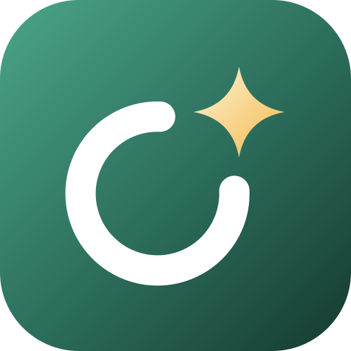
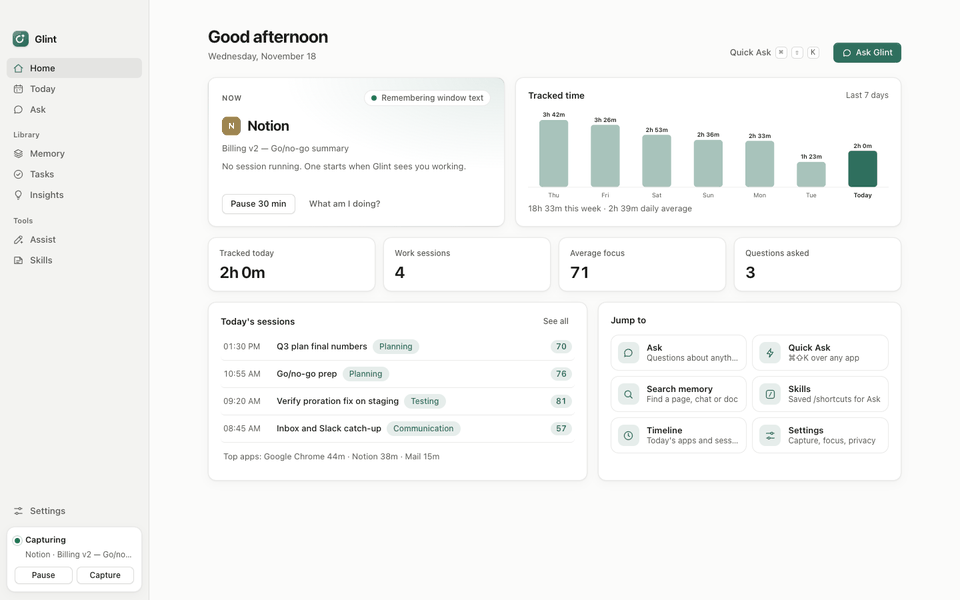
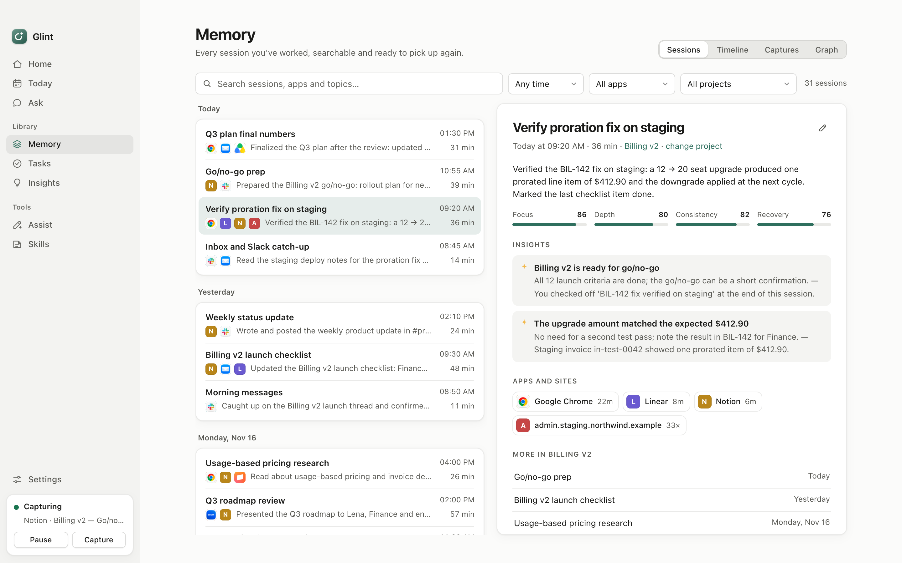
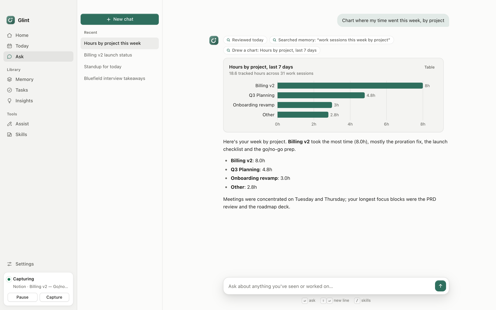
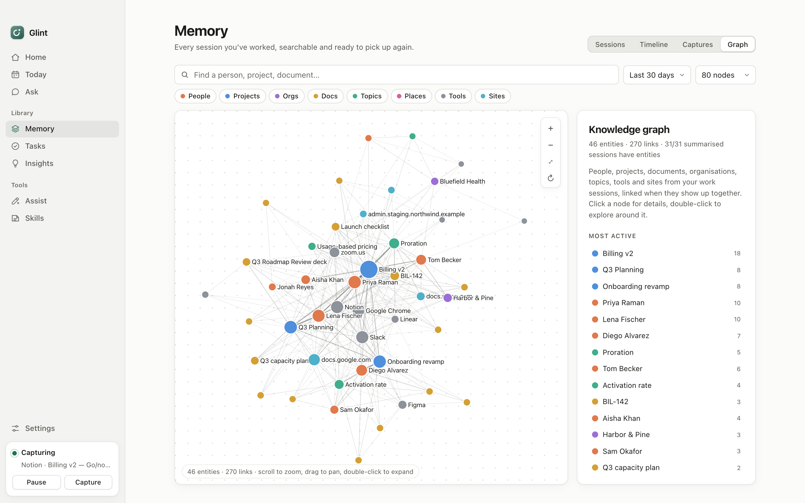
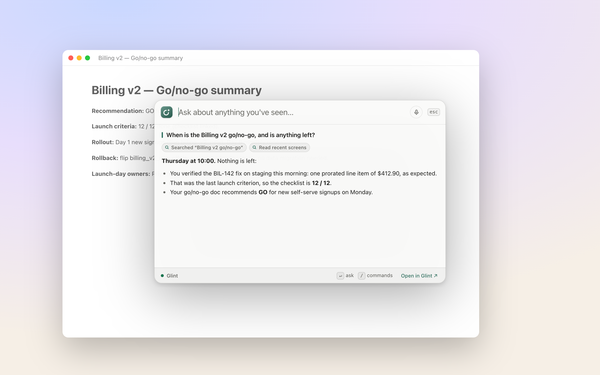
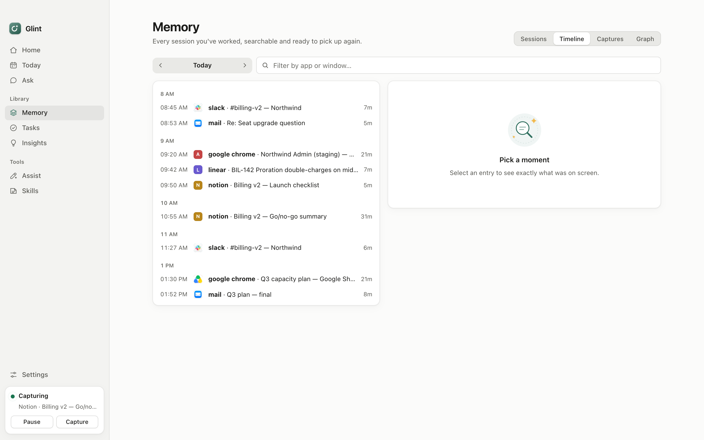
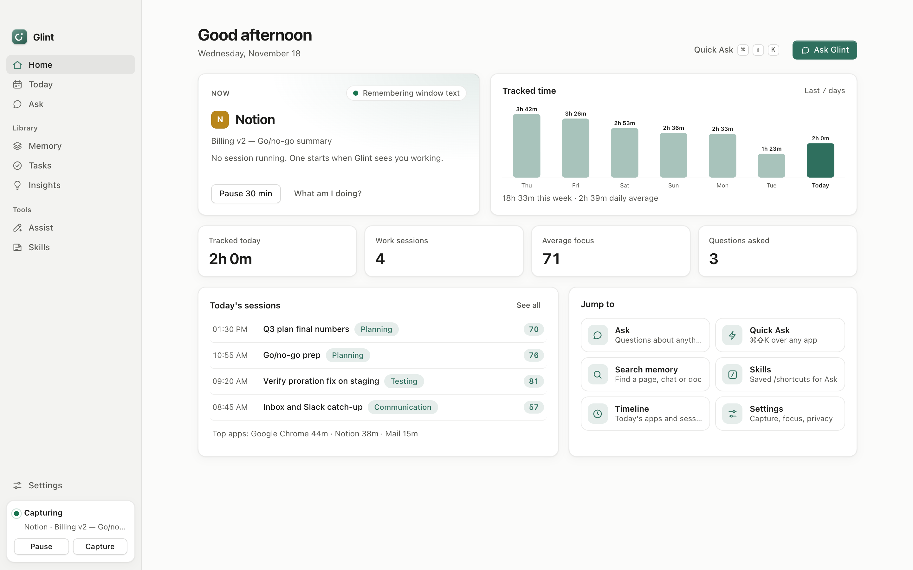

<p align="center">
  
</p>

<h1 align="center">Glint</h1>

<p align="center">
  <b>Your Mac's memory. Private, local, open source.</b><br>
  Glint remembers the text of everything you work on, turns your day into searchable work sessions,
  and answers questions about it, with Apple's on-device model by default. No account. No cloud. No key required.
</p>

<p align="center">
  <a href="LICENSE"></a>
  
  <a href="https://github.com/Rikinshah787/Glint/releases/latest"></a>
  <a href="CONTRIBUTING.md"></a>
</p>

<p align="center">
  <a href="https://github.com/Rikinshah787/Glint/releases/latest"><b>Download</b></a> ·
  <a href="#try-it-in-30-seconds-no-permissions">Try the demo</a> ·
  <a href="docs/features.md">Features</a> ·
  <a href="docs/privacy.md">Privacy</a> ·
  <a href="docs/mcp.md">Use with Claude &amp; Cursor</a> ·
  <a href="docs/faq.md">FAQ</a>
</p>

<p align="center">
  
</p>

<sub>All screenshots use Glint's built-in demo data: a fictional week for "Maya Chen", a product manager at a made-up company.</sub>

## Free forever

Glint is a community project, not a product. **It is and will stay 100% free and open source (MIT):**
no paid plans, no "Pro" tier, no usage limits, no account, no sign-up, no ads, no telemetry.
The default AI runs on your Mac at no cost. If you choose to add a Claude or OpenAI key, you pay
those providers directly for what you use — Glint never sees or bills anything.

## Why Glint

- **Local-first.** Captured text, embeddings, sessions and chats live in one SQLite file on your Mac.
  Glint has no server and no account. Search runs entirely on-device.
- **No API key needed.** On Macs with Apple Intelligence, Ask, summaries, autocomplete and dictation
  cleanup run on Apple's on-device model. Prefer Claude or OpenAI? Add your own key; it stays in the Keychain.
- **Text, not screenshots.** Glint reads window text through macOS Accessibility (with an optional OCR
  fallback). That is small, fast to search, and skips password fields, password managers and private windows.
- **Give your AI tools a memory of your Mac.** A built-in [MCP server](docs/mcp.md) lets Claude Desktop,
  Claude Code and Cursor search what you've worked on, with per-app tokens and screen text off by default.
- **Hackable.** Every feature is a [plug-in](docs/PLUGINS.md): one Python file, one JS file, optionally one Swift file.
  MIT licensed.

## Try it in 30 seconds (no permissions)

See the whole UI on fictional demo data, in your browser. Nothing is captured and nothing is read from your Mac.

```bash
git clone https://github.com/Rikinshah787/Glint.git && cd Glint
scripts/setup.sh      # Python 3.10+ → .venv
scripts/demo.sh       # seeds a temp folder, starts the engine, opens http://127.0.0.1:47408/
```

Ask works in the demo too if Apple Intelligence is on, or if `ANTHROPIC_API_KEY` / `OPENAI_API_KEY` is set.

## Feature tour

<table>
<tr>
<td width="50%"><b>Work sessions with AI reports</b><br>Your day, split into sessions with a title, summary, project, focus/depth/consistency/recovery scores and insights.<br><br>
<picture><source media="(prefers-color-scheme: dark)" srcset="docs/images/memory-sessions-dark.png"></picture></td>
<td width="50%"><b>Ask, with visual answers</b><br>An agent that searches your memory, reads recent screens, manages tasks, and draws charts and diagrams.<br><br>
<picture><source media="(prefers-color-scheme: dark)" srcset="docs/images/ask-chart-dark.png"></picture></td>
</tr>
<tr>
<td><b>Knowledge graph</b><br>People, projects, documents, orgs and topics from your sessions, linked by when they show up together.<br><br>
<picture><source media="(prefers-color-scheme: dark)" srcset="docs/images/graph-dark.png"></picture></td>
<td><b>Quick Ask anywhere</b><br><kbd>⌘</kbd><kbd>⇧</kbd><kbd>K</kbd> over any app. It can see the window you're in and point at things on screen.<br><br>
<picture><source media="(prefers-color-scheme: dark)" srcset="docs/images/quick-ask-dark.png"></picture></td>
</tr>
<tr>
<td><b>Timeline</b><br>Every app and window, minute by minute, linked to the captured text.<br><br>
<picture><source media="(prefers-color-scheme: dark)" srcset="docs/images/timeline-dark.png"></picture></td>
<td><b>Home and insights</b><br>Where your time went this week, today's sessions, and patterns worth knowing.<br><br>
<picture><source media="(prefers-color-scheme: dark)" srcset="docs/images/home-dark.png"></picture></td>
</tr>
</table>

**Also in the box**

| | |
|---|---|
| **Hybrid search** | SQLite FTS5 (BM25) + local MiniLM embeddings, fused with reciprocal rank fusion, plus session-level documents and entity aliases from the graph. |
| **Autocomplete everywhere** | Inline suggestions in any text field; <kbd>Tab</kbd> accepts. Learns your voice per app, on-device. |
| **Dictate** | Hold <kbd>⌃</kbd><kbd>⌥</kbd>, speak, release: cleaned-up text is typed at your cursor, styled for the app (casual for chat, formal for email). |
| **Assist** | Tap <kbd>⌥</kbd><kbd>⌘</kbd> to draft into the focused field; optional suggestion cards with one-click actions and undo. |
| **Glance** | <kbd>⌃</kbd><kbd>⇧</kbd><kbd>G</kbd> explains the current window in a small card. |
| **Connectors** | Read-only Gmail, Drive and Calendar for Ask (your own Google OAuth client), and import what other assistants remember about you. |
| **Tasks, skills, lasting memory** | Tasks with progress logs, `/skills` (saved prompts), a bio and a memory doc you and the assistant can edit. |

Full list: [docs/features.md](docs/features.md).

## Quick start

**Download** the latest DMG from [Releases](https://github.com/Rikinshah787/Glint/releases/latest)
(Apple silicon, macOS 13.4+), drag Glint to Applications, open it, and follow the setup wizard:

1. Grant **Accessibility** (System Settings → Privacy & Security → Accessibility). Required to read window text.
2. Pick an AI model: Apple's on-device model (macOS 26+ with Apple Intelligence turned on), or paste a Claude/OpenAI key.
3. Work normally. Sessions appear in **Memory** as you go; press <kbd>⌘</kbd><kbd>⇧</kbd><kbd>K</kbd> to ask.

**Build from source** (needs Xcode 26 or its Command Line Tools, and Python 3.10+):

```bash
git clone https://github.com/Rikinshah787/Glint.git && cd Glint
make setup     # .venv with the engine's dependencies
make run       # builds build/Glint.app and opens it
```

More: [docs/install.md](docs/install.md) (signing, permissions, packaging a DMG) and
[docs/troubleshooting.md](docs/troubleshooting.md).

## Privacy

| | |
|---|---|
| **What's stored** | Window text (not pixels), app and window titles, site hostnames, timestamps, embeddings, session reports, chats, tasks. |
| **Where** | `~/Library/Application Support/Glint` (one SQLite database + settings). API keys and Google tokens in the macOS Keychain. |
| **What leaves the Mac** | Nothing, with the on-device model. With Claude or OpenAI, only the text a request needs goes to that provider, with your key. Favicons are fetched from sites you visited (can be turned off). Connectors talk to Google only if you connect them. |
| **Never captured** | Password fields, password managers, private/incognito windows, Glint itself, and any app you block. |
| **How to delete** | Delete single captures or sessions in Memory; delete all captured text or set retention (14/30/90/365 days) in Settings → Privacy; or quit Glint and remove the folder above to erase everything. |

Details, including exactly what each AI feature sends: [docs/privacy.md](docs/privacy.md).

## How Glint compares

| | Cloud memory / notes AI | Screenshot-based recorders | **Glint** |
|---|---|---|---|
| Where your data lives | Vendor's servers | Your Mac | **Your Mac** |
| What is recorded | What you paste or sync | Screen images (+ OCR) | **Window text** (OCR optional) |
| Storage footprint | n/a | Large (images) | **Small** (text + vectors) |
| Works without an account or API key | Rarely | Varies | **Yes** (Apple's on-device model) |
| Other AI apps can query it (MCP) | Varies | Varies | **Yes**, local and token-gated |
| Source code | Usually closed | Varies | **MIT** |

Trade-offs, honestly: Glint keeps text, not a visual replay of your screen; it is macOS-only, the DMG is
Apple silicon only, and it is early software (v0.1).

## Use your memory from Claude, Cursor and Claude Code

Turn on Settings → AI apps, create a token, and paste the snippet Glint shows. Tools exposed:
`search_memory`, `get_recent_context`, `get_today_activity`, `list_tasks`. Setup for each client:
[docs/mcp.md](docs/mcp.md).

## Architecture

```
Glint.app (Swift)  ── menu bar, windows, hotkeys, Quick Ask, dictation, autocomplete, overlays
   │  WKWebView ── web/ (HTML/JS UI)
   ▼
engine (Python, 127.0.0.1 + per-launch token)
   ├─ capture loop ── glint-capture (Accessibility, OCR fallback)
   ├─ memory ── SQLite FTS5 + MiniLM embeddings (fastembed/ONNX) → hybrid search (RRF)
   ├─ sessions, graph, Ask agent, assist, autocomplete, visual, connectors (engine/features/*)
   ├─ AI ── glint-llm (Apple FoundationModels) | Claude | OpenAI
   └─ MCP server (127.0.0.1, bearer tokens)
```

More in [docs/architecture.md](docs/architecture.md). Writing a feature: [docs/PLUGINS.md](docs/PLUGINS.md).

## FAQ

**Does Glint record my screen?** No video and no screenshots are stored. It reads text through Accessibility.
Quick Ask and Glance can attach a screenshot of the current window to a single AI request if you grant Screen
Recording; it is not saved to memory. → [docs/faq.md](docs/faq.md)

**Is it free?** Yes, MIT. With Apple's on-device model there is nothing to pay for. Cloud models bill your own account.

**How much disk does it use?** Mostly text and small vectors: the demo week (about 1,600 captures across 31 sessions) is under 6 MB. Add ~90 MB once for the embedding model.

**Can I use it on Intel or Windows?** The released DMG is Apple silicon only; there is no Windows or Linux version.

More: [docs/faq.md](docs/faq.md) · [docs/troubleshooting.md](docs/troubleshooting.md)

## Roadmap

Ideas we want to build, not promises. Discuss or pick one up in [Issues](https://github.com/Rikinshah787/Glint/issues).

- [ ] Notarized releases (needs a donated/sponsored Apple Developer account; until then, right-click → Open)
- [ ] More connectors (read-only): calendar and mail providers beyond Google, local folders
- [ ] Export your memory (Markdown / JSON) and per-project retention
- [ ] Richer MCP tools (sessions, graph queries) with per-tool permissions
- [ ] Plug-in gallery and a template repo for community features
- [ ] Localized UI

## Contributing

PRs welcome, small or large. Start with [CONTRIBUTING.md](CONTRIBUTING.md): `scripts/demo.sh` gives you the full UI
on fake data, and most features live in a single plug-in file. Please read the
[Code of Conduct](CODE_OF_CONDUCT.md); report security issues privately per [SECURITY.md](SECURITY.md).

## License

[MIT](LICENSE)

<p align="center"><b>If Glint is useful to you, a ⭐ helps other people find it.</b></p>
