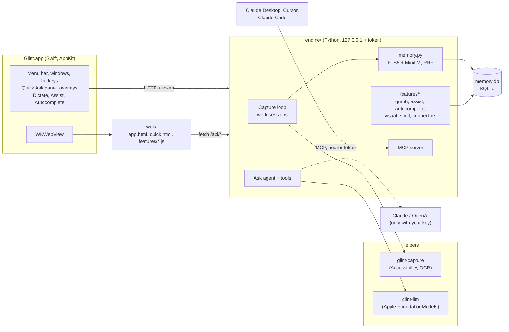

# Architecture

Glint is three small programs that talk over localhost: a native Swift shell, a Python engine and a web UI.



## Components

| Path | What it is |
|---|---|
| `mac/*.swift` | The app: menu bar, main window and Quick Ask panel (WKWebView), global hotkeys (Carbon), dictation (AVFoundation / Speech), Assist chord, autocomplete event tap, screen overlays, native feature registry (`Features.swift`). Starts and supervises the engine. |
| `mac/capture/GlintCapture.swift` → `bin/glint-capture` | One-shot helper: frontmost app, window title, URL and focused-window text via Accessibility, skipping secure text fields; optional OCR (Vision). Prints JSON. |
| `mac/llm/GlintLLM.swift` → `bin/glint-llm` | Long-running JSON-lines server around Apple's on-device `SystemLanguageModel` (macOS 26+). |
| `engine/engine.py` | HTTP API, settings, capture loop, work sessions and their AI reports, Ask agent and its tools, dictation, plug-in loader. |
| `engine/memory.py` | Storage and retrieval: chunks, passages, FTS5, embeddings, session docs, synonyms, hybrid search. Also a CLI. |
| `engine/ai.py` | Providers (Apple, Claude, OpenAI) behind one interface: tool-use loop, streaming, JSON output. |
| `engine/features/*.py` | Plug-ins: knowledge graph, Assist, autocomplete, visual answers + Glance, shell (home, skills, nudges, imports), connectors (Google, MCP, memory import). |
| `web/` | UI pages; `web/features/*.js` are injected per page. |
| `engine/demo.py` | Fictional demo data + a sandboxed engine runner (`scripts/demo.sh`). |

## Data flow: from a window to an answer

1. **Poll.** About once a second the capture loop asks `glint-capture --peek` for the frontmost app and title.
   Blocked apps, private windows and system surfaces are skipped.
2. **Snapshot.** On session start, after focus settles on a new window, or every 20 s on the same window,
   it takes a full text snapshot. Unchanged text (same hash, app and title) is ignored.
3. **Index.** `memory.add_chunk` stores the snapshot and splits it into ≤450-character passages
   (deduplicated by hash); `embed_pending` embeds new passages with MiniLM (384-d, L2-normalised) on-device.
4. **Sessions.** A session ends after 3 minutes idle. The model writes a structured report (JSON schema);
   hooks then extract graph entities from the same call and index a session-level search document.
5. **Search.** A query runs as several ranked lists (passage BM25, title BM25, passage cosine,
   session-doc BM25 and cosine), fused with reciprocal rank fusion (k = 60), with alias expansion,
   time-hint boosts, light recency, and near-duplicate suppression.
6. **Ask.** The agent gets an opening context (time, recent activity, bio, lasting memory, plug-in context)
   and calls tools (`search_memory`, `get_recent_context`, `read_session`, tasks, charts, …) until it answers.
   Events stream to the UI over server-sent events.

## Storage

One SQLite database, `memory.db` (WAL mode), in `~/Library/Application Support/Glint` (override with
`GLINT_HOME`). Core tables: `memory_chunks`, `memory_passages` (+ FTS5), `memory_session_docs` (+ FTS5),
`memory_synonyms`, `sessions`, `chat_threads`, `chat_messages`, `tasks`, `kv`, `dictation_dictionary`.
Plug-ins create their own tables (`graph_*`, `assist_*`, `autocomplete_samples`, `skills`,
`connector_*`, …). Settings are in `settings.json`; secrets in the Keychain.

## Security model

- The engine binds to `127.0.0.1`, rejects non-local `Host` headers, and requires a per-launch random token
  (`X-Glint-Token`) for every `/api/*` route. Pages get the token injected when served.
- The MCP server is separate, local-only, and authenticates each client with its own bearer token
  (stored hashed). Screen text is excluded from MCP results unless enabled.
- Captured text is never written to logs.

## Environment variables (development)

| Variable | Effect |
|---|---|
| `GLINT_HOME` | Data folder (default `~/Library/Application Support/Glint`) |
| `GLINT_PORT` | Engine port (default 47321) |
| `GLINT_TOKEN` | Fixed API token instead of a random one |
| `GLINT_NO_CAPTURE=1` | Run the engine without the capture loop |
| `ANTHROPIC_API_KEY` / `OPENAI_API_KEY` | Fallback keys when none is in the Keychain |

Headless engine for development:

```bash
GLINT_HOME=$(mktemp -d) GLINT_NO_CAPTURE=1 GLINT_PORT=47408 .venv/bin/python engine/engine.py
```

## Extending

See [PLUGINS.md](PLUGINS.md): a feature is a Python module with `register()`, an optional web script and
an optional Swift class, with no changes to the core.
