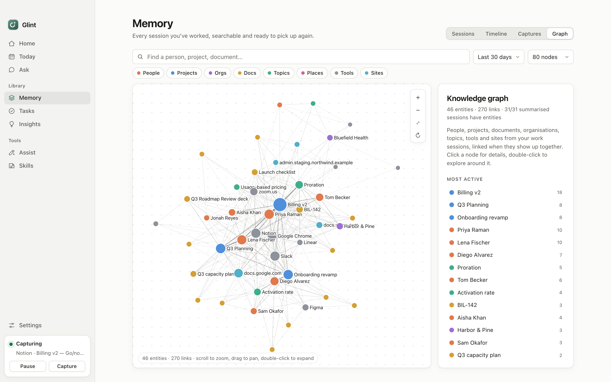
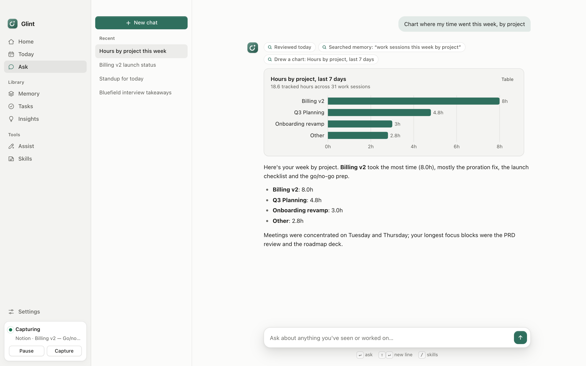

# Features

Every feature below can be turned off in Settings. Screenshots use the fictional demo data.

## Memory

**Capture.** About once a second Glint checks the frontmost app and window. It takes a full text snapshot
when a work session starts, when focus settles on a new window, and every 20 s (configurable) while a window
stays focused, storing it only if the text changed. Text comes from macOS Accessibility; an optional OCR
fallback covers apps without accessible text. Password fields, password managers, private/incognito
windows, system authentication surfaces and Glint itself are never captured. You can block more apps,
or limit text capture to a list of apps (others get titles only).

**Work sessions.** Activity is grouped into sessions that end after 3 minutes without input. When one ends,
the AI model writes a report: a short title, a 1-3 sentence summary, the project, the dominant activity,
four 0-100 scores (focus, depth, consistency, recovery) with a rationale, and up to three insights with the
evidence behind them. You can rename, re-project, annotate, re-summarize or delete any session.

**Search.** Hybrid retrieval over passages (≤450 characters) of captured text:
SQLite FTS5 with BM25, local `all-MiniLM-L6-v2` embeddings (fastembed / ONNX), and session-level documents,
fused with reciprocal rank fusion (k = 60). Queries are expanded with aliases from the knowledge graph,
time phrases ("yesterday", "last week") boost matching windows, and near-duplicate captures are collapsed.

**Timeline.** Each day as a strip of apps and windows, linked to the captured text.

**Knowledge graph.** People, projects, organisations, documents, topics, tools, places and sites that
appear in your sessions, with links weighted by co-occurrence (decaying over ~30 days). Entities come from
the session report at no extra AI cost; older sessions can be backfilled. Merge, rename, edit aliases or
delete (deleted names are never re-created).

<picture><source media="(prefers-color-scheme: dark)" srcset="images/graph-dark.png"></picture>

## Ask and Quick Ask

**Ask** is a chat with an agent that can search memory, read recent screens, review a day, read a session,
manage tasks, update your bio and lasting-memory doc, search the web (Claude only) and use connected tools.
Tool calls show as chips above each answer.

**Quick Ask** (<kbd>⌘</kbd><kbd>⇧</kbd><kbd>K</kbd>, or hold the Assist chord) is a floating box over any
app with shortcuts `/find`, `/summarize`, `/task`, `/log`. With Screen Recording granted it sees the
window you were in, and can point at things on screen with callouts and highlights.

**Visual answers.** Ask and Quick Ask can draw bar, line and ring charts, stat tiles, flowcharts
(including Mermaid-style diagrams) and simple illustrations, rendered locally from structured data.

<picture><source media="(prefers-color-scheme: dark)" srcset="images/ask-chart-dark.png"></picture>

**Glance** (<kbd>⌃</kbd><kbd>⇧</kbd><kbd>G</kbd>) explains the current window in a small card.

**Skills** are saved prompts with a `/trigger` (e.g. `/standup`), usable in Ask and Quick Ask, importable
as Markdown. Ask can create them for you.

## Writing help

**Autocomplete everywhere.** After a short typing pause in any text field, Glint suggests a continuation.
<kbd>Tab</kbd> (or <kbd>`</kbd>) accepts the next phrase, <kbd>⇧</kbd><kbd>Tab</kbd> one word,
<kbd>↓</kbd> cycles options, <kbd>Esc</kbd> dismisses, <kbd>⌥</kbd><kbd>Tab</kbd> asks right away.
Skips password fields, code editors and terminals; can be disabled per app. It learns from text you accept,
kept per app on your Mac. Runs on Apple's on-device model when available.

**Dictate.** Hold <kbd>⌃</kbd><kbd>⌥</kbd>, speak, release (<kbd>Esc</kbd> cancels). The transcript is
cleaned up in a style that fits the app (casual for chat, formal for email) with your own dictionary, then
typed at the cursor. Transcription uses OpenAI Whisper with an OpenAI key, otherwise Apple's on-device
speech recognizer.

**Assist.** A two-key chord (default <kbd>⌥</kbd><kbd>⌘</kbd>): tap to draft into the focused field, hold for
Quick Ask, double-tap for an edge panel. Optional suggestion cards offer actions (create a task, open a
link, insert text) with one-minute undo. Everything offered is kept in a reviewable history.

## Your context

- **Tasks** with progress and logs, editable by you and by Ask.
- **Bio and lasting memory**: two documents the assistant reads at the start of every chat.
- **Home**: what you're doing now, tracked time over 7 days, today's sessions; optional focus nudges for
  distracting apps or sites and a session HUD.
- **Insights**: a feed of session insights you can rate up or down; ratings steer future insights.

## Connectors

- **Google (read-only)**: search and read Gmail, search and read Drive files, list upcoming Calendar events.
  Uses your own Google Cloud OAuth client (installed-app flow with PKCE, loopback redirect). Tokens in the Keychain.
- **AI apps (MCP)**: a local MCP server for Claude Desktop, Claude Code, Cursor and others. See [mcp.md](mcp.md).
- **Bring in memories**: paste what another assistant remembers about you; facts are distilled into their
  own removable section of your lasting-memory doc.
- **Browser history import**: Chrome, Safari (needs Full Disk Access) and Firefox, on request.

## AI models

| Provider | Key | Notes |
|---|---|---|
| Apple on-device (default) | none | macOS 26+, Apple silicon, Apple Intelligence on. Nothing leaves the Mac. |
| Claude | your Anthropic key | Best for long Ask sessions and web search. |
| OpenAI | your OpenAI key | Also used for Whisper transcription if set. |

"Auto" picks a cloud model when you've added a key, otherwise the on-device model. Quick tasks
(autocomplete, dictation cleanup) can stay on-device even when Ask uses a cloud model.
